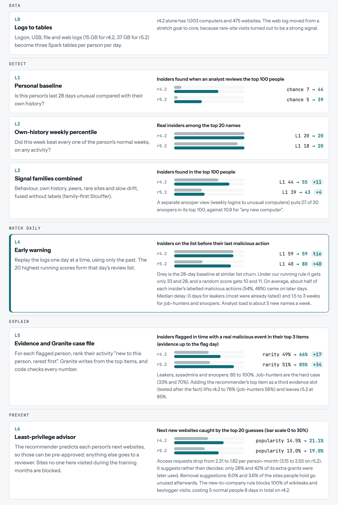

# What we're building

**OutOfRole spots insiders while they are still active, explains each alert with checked evidence, and suggests which access each person should keep pre-approved.** It all runs on one LinuxONE server, and people appear only as pseudonyms (U-017).

1. **Early warning (the headline).** Replay the logs day by day. Compare each person with their own normal weeks; the 20 most unusual people form a daily review list.
2. **Granite case files.** For each person on the list, code picks the evidence ("new to this person, rarest first"). Granite writes the explanation citing it, and code checks every number before anyone sees it.
3. **Least-privilege advisor (the recommender).** A recommender predicts which websites each person is likely to use next. Those can be pre-approved; anything else goes to a reviewer. Sites no one in the company visited during the training months are blocked.

**Pitch line:** "In a day-by-day replay of 2,000 employees' logs, OutOfRole put 80 of 99 insiders on a 20-name daily review list while their attacks were under way, twice as many as a standard 28-day baseline at the same workload, and on average about half of each one's malicious actions came after the flag. Granite, on the same server, writes a case file citing the evidence. A recommender suggests which access to pre-approve, so reviewers see fewer routine requests."

\newpage

# Level by level: what happens and what it buys us

Each level runs on the output of the one above it. Grey bars show the reference (chance or the previous best), and teal bars show the level. Release r4.2 has 70 insiders among 1,000 staff; r5.2 has 99 among 2,000. "Chance" at L1 is the expected number of insiders in 100 randomly chosen people.

{ width=76% }

# Numbers we tested

CERT data. Settings were frozen on r4.2, then r5.2 was run unchanged. Each number was reproduced with independent code.

| Claim | r4.2 (70 insiders) | r5.2 (99 insiders) |
|------------------------------------------|----------|----------|
| Insiders on the daily list before their last malicious action | **59** | **80** |
| Same, 28-day personal baseline at similar list churn (the fair comparison) | 59 | 40 |
| Same, 28-day baseline under our running rule (the pre-registered comparison) | 33 | 28 |
| Same, by chance (shuffled real list histories) | about 3 | about 3 |
| Same, a random score on the same 20-name list | 10 | 11 |
| Average share of each insider's labelled malicious actions on days after the flag | 54% | 48% |
| New names per week for the analyst | about 5 | about 5 |
| Insiders flagged in time with a real malicious event in their top 3 evidence items, using evidence up to the flag day (global rarity in brackets) | 66% (49%) | 85% (51%) |
| Next new websites caught by the recommender's top 20 (popularity in brackets) | 21% (14.5%) | 19% (13%) |
| Access requests per person per month: history only, then with the recommender | 2.3 to 1.8 | 3.15 to 2.55 |
| Held sites never used again (removal suggestions for access admins) | 6.0% | 3.6% |
| Wikileaks and keylogger visits blocked by the new-to-company rule | 100% | 100% |
| Case files with strong evidence, insiders vs normal staff (no labels used) | 53% vs 18% | 72% vs 30% |

**By attack type:**

- Leakers: median delay 0 days from the first labelled malicious day, mostly because they were already on the list. Only 7 of 30 and 15 of 29 were newly flagged.
- Job-hunters and snoopers are flagged after 1.5 to 3 weeks.
- Two-day sysadmin sabotage is mostly missed: 4 of 10 on r4.2, 2 of 10 on r5.2.

\newpage

# Step by step: what each test changed

"Found" = insiders expected in the top 70. Full detail: the notebook and `feasibility/Verified_Numbers.md` section 7.

| Step | What we tried | Metric | Before | After | Change | Verdict |
|----|------------------|--------------|----------|----------|----------|----------|
| 3 | Personal 28-day baseline | found, r4.2 / r5.2 | none | 38 / 36 | the bar | bar |
| 4 | Rare-site visits | found, r4.2 | 38 | 41 | +3 (r5.2: 8.1) | one family |
| 5, 6 | Trained combiners | found, r4.2 | 39 | 45 to 60 | +6 to +21 | fail on new attacks |
| 7 | Label-free sum, job-hunters hidden | job-hunters in top 100 | 4 to 7 | 16 of 30 | +9 to +12 | label-free wins |
| 8 | Weekly LOF (literature) | job-hunters in top 100 | 5 | 12 to 13 | +7 to +8 | slow drift |
| 10 | Own-history weekly percentile | found, r4.2 | 38 | 39.4, P@20 1.00 | +1.4 | core |
| 11 | Family-first Stouffer fusion | found, r4.2 | 38 | 45 | +7 | frozen |
| 12 | Same pipeline on r5.2, frozen | found, r5.2 | 36 | 38 | +2 | survives |
| 13 | Snooper persistence signal | snoopers in top 100 | 10.9 | 27 of 30 | +16 | view |
| 14 | Exactly 100 reviews | insiders, r4.2 / r5.2 | 44 / 39 | 55 / 43 | +11 / +4 | default ranking |
| 16 | Recommender, tuned without labels | next-site recall@20, r4.2 | 0.145 (popularity) | 0.211 | 1.45x | real job |
| 17 | Least-privilege advisor | requests per person-month | 2.31 / 3.15 | 1.82 / 2.55 | -21% / -19% | build |
| 18 | Evidence rule for Granite | hit@3, insiders flagged in time | 0.49 / 0.51 (rarity) | 0.66 / 0.85 | +0.17 / +0.34 | build |
| 19 | Early warning, day by day | flagged in time, r4.2 / r5.2 | 59 / 40 (baseline, similar churn) | 59 / 80 | 0 / +40 | headline |
| 20 | Analyst feedback; richer recommenders | insiders in 100 reviews | 55 / 43 | 57 / 42 | noise | dropped |

Steps 1, 2, 9 and 15 were checks or were superseded:

- Step 1: data loading.
- Step 2: the leakage check.
- Step 9: recommender tweaks (peer-of-item: 17 found).
- Step 15: the untuned recommender verdict, replaced by Step 16.

\newpage

# Who builds what

Fill in names. Hours count from the start of our build.

| Role | Hours 0 to 6 | Hours 6 to 12 | Hours 12 to 18 | Hours 18 to 24 |
|--------------|------------------|------------------|------------------|------------------|
| **R1 Data and platform** (\_\_\_\_\_\_) | VM: Java 17, PySpark (no pyarrow on s390x), Docker; download r4.2. At hour 2, hand a one-month sample to R2 and R4. Spark builds 3 tables: daily counts, person-computer-day, person-site-day | r5.2 if disk allows; run the whole pipeline end to end | Docker container, GitHub repo, README | Support the demo; check the repo runs from scratch |
| **R2 Detection** (\_\_\_\_\_\_) | Port section 1 of `outofrole_minimal.py` (the daily list) and run it on the sample | Run on r4.2 with the fixed settings below | r5.2 unchanged; results table vs baseline and chance, per attack type, analyst load | Export daily lists and per-person timelines for the dashboard |
| **R3 Granite** (\_\_\_\_\_\_) | Both IBM labs (Granite via llama.cpp; the model file must be big-endian) | Port `case_items` from `outofrole_minimal.py` and all of `case_file.py` (evidence pack with IDs, Granite prompt, number checker, weak-evidence flag, fallback); pseudonyms | Pre-generate case files for the top 20; keep one live run | Case-file panel in the dashboard |
| **R4 Recommender and demo** (\_\_\_\_\_\_) | Dashboard skeleton: daily list, person page, case-file panel | Port sections 3 to 5 of `outofrole_minimal.py`: ALS on person-site data, top-20 pre-approval, removal suggestions, new-to-company block | Wire everything into the dashboard | Video with on-screen proof: `uname -m` (s390x), `docker ps`, the server prompt |

**Fixed detector settings (decide nothing new):**

- A feature is unusual when the last 7 days beat every one of that person's training weeks.
- The running score halves every 7 days.
- The list holds 20 names a day.

**Recommender settings:** rank 64, alpha 0.5, regularization 1.0 on log(1 + active days), using the numpy version in `recommender_als_simple.py`. Spark's ALS scales regularization differently, so if you use it, re-tune on the last training month and pick by how many next-month new sites it catches.

# Cut rules

- **Hour 6:** if the Spark tables aren't ready, run r4.2 with logon, USB and file data only; add web later.
- **Hour 12:** freeze the detector settings. No tuning after this.
- **Hour 14:** if the recommender is behind, ship the new-to-company block plus each person's own history as the allow-list. Cite the recommender's local result instead.
- **Hour 18:** if Granite is slow or unreliable, show the pre-generated case files plus one live run. If it fails entirely, show the checked evidence pack itself.
- **Hour 20:** feature freeze. Only the video, README and slides from here.

# Demo (3 minutes)

1. The replay plays. A leaker joins the daily list on the day of the first wikileaks upload.
2. Click the person. Granite's case file streams in, and each number turns green once the code confirms it.
3. Access panel: 20 pre-approved sites. A request for wikileaks.org is blocked as new to the company.

# Say this, not that

- Say "flags insiders while they are still active", not "real-time production system". It is a replay of past logs.
- Say "the recommender predicts legitimate access", not "the recommender detects insiders". We tested that: as a detector it is no better than popularity.
- Say openly that two-day sysadmin sabotage is mostly missed, and that CERT is synthetic data.
- Say "suggests which access to pre-approve", not "trims access to what people need". Only 28% (r4.2) and 42% (r5.2) of the recommender's extra grants were later used.
- Say plainly that the approach changed after testing. The abstract promised recommender-based detection; our tests showed that own-history baselines detect better, so the recommender moved to access advice.
- Compare against the strongest baseline. At similar list churn, the 28-day baseline flags 59 of 70 (a tie on r4.2) and 40 of 99 (half of ours on r5.2).
- The early-warning method was picked after seeing results. The full detector we had named in advance also beat the baseline: 54 vs 28 of 99 r5.2 insiders flagged in time.

# Reference code (local tests; we rewrite on the server)

In `feasibility/reference/`:

- **`outofrole_minimal.py`**: the whole system in about 210 lines, and the file to port. It produces every headline number in about 20 seconds per release.
- **`case_file.py`**: 61 lines covering the evidence pack, the Granite prompt, the number checker and the fallback. Run it to see the self-test.
- `early_warning_simple.py`: the 49-line replay behind the headline numbers.
- `early_warning_full.py`: the full replay with baseline, chance and analyst-load comparisons.
- `evidence_ranking.py`: evidence ranking for the case files.
- `recommender_als_simple.py`: the ALS recommender against popularity.
- `least_privilege_full.py`: the full least-privilege experiment.
- `org_novel_sites.py`: the new-to-company site check.

The full study is in `feasibility/OutOfRole_Feasibility.ipynb`; data download steps are in `Data_Access_Guide.pdf`.
